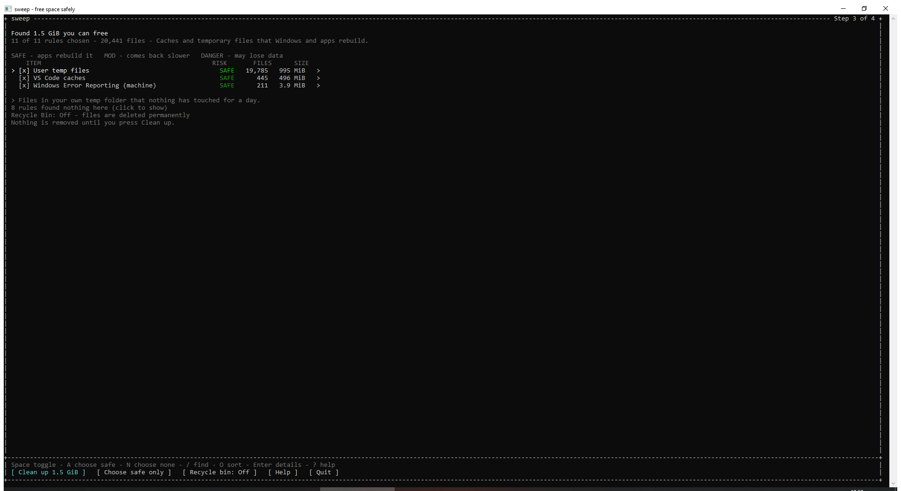
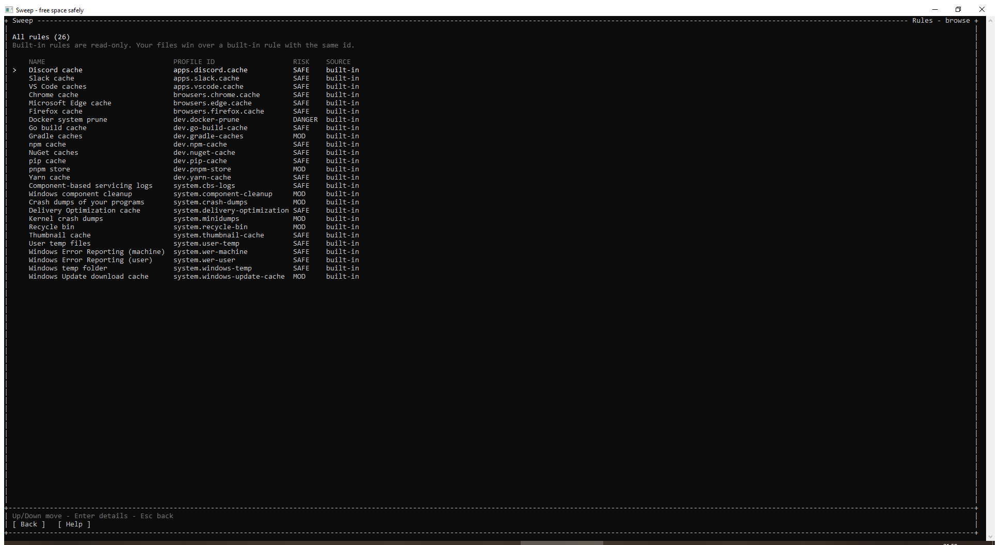
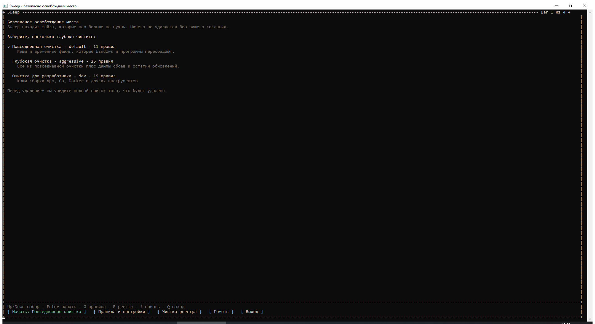
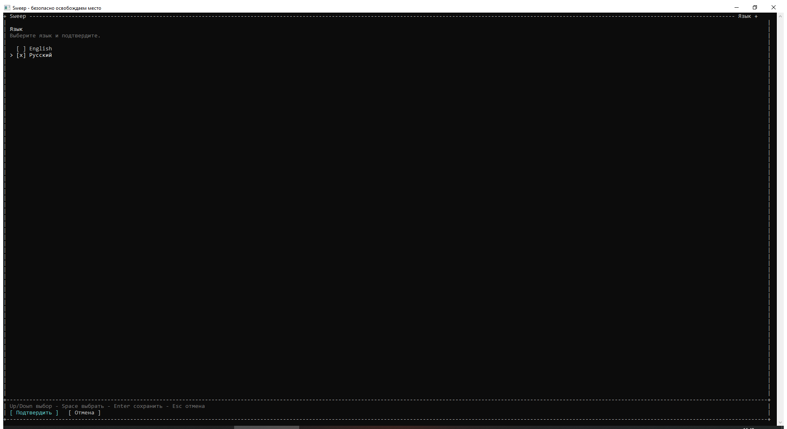
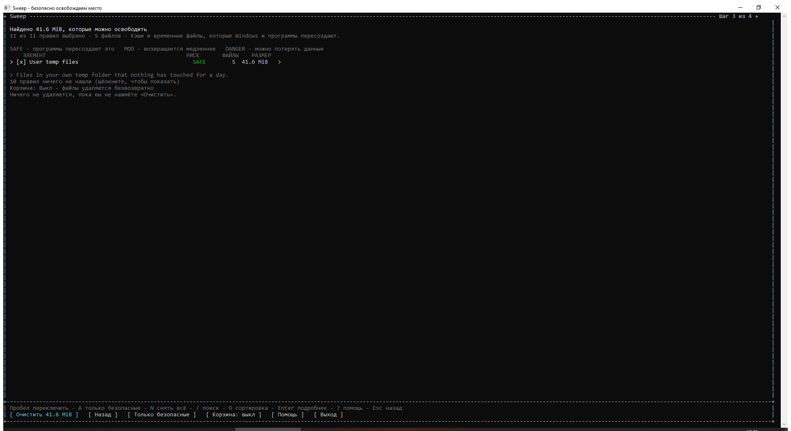

# Sweep

Sweep frees space on Windows 10 and 11 by rules written in YAML. The Go core
scans the disk, shows a plan, and deletes only what you approve. One binary
gives you both a terminal interface and scriptable commands.

```
sweep              # the terminal interface
sweep scan         # what would be cleaned, without changes
sweep clean        # the run itself
sweep list         # the rules and the profiles
sweep rules ...    # check, show and validate rules
sweep registry ... # find and remove dead registry entries
```

## Status

The eight stages of the specification: stages 0-6 are done.

| Stage | State |
| --- | --- |
| 0. Skeleton | done |
| 1. Rules and config | done |
| 2. Guard and platform | done |
| 3. Scanner | done |
| 4. Executor and `clean` | done |
| 5. Terminal interface | done |
| 6. Rule set and documentation | done |
| 7. Extensions after the first release | in progress: the rule browser, the config viewer, the user-rule editor and the registry cleanup are here; the rest is listed below |

The built-in set has 26 rules: browser and app caches, system temp folders,
Error Reporting, servicing logs, crash dumps, update leftovers, and developer
caches. Every path was probed on a real Windows 10 22H2 machine; the table of
what was checked, and what could not be checked here, is in
[`docs/rules.md`](docs/rules.md). Windows 11 is marked `not verified`.



## Quick start

Requires Go 1.27 or newer.

```sh
go build -o sweep.exe ./cmd/sweep
.\sweep.exe
```

The first screen offers three ways to clean. Choose one, press Enter, wait for
the scan, review the list, and press `c` to continue. Nothing is removed until
you confirm.

To see the plan without opening the interface:

```sh
.\sweep.exe scan
.\sweep.exe clean --dry-run
```

## The terminal interface

The interface is built for people who have never cleaned a disk by hand. It
has four steps: choose, scan, review, confirm. Every row and every button
answers the mouse; every action also has a key.

**Start.** Three named profiles explain themselves in one line:

- `default` - Everyday cleanup: caches and temp files that Windows rebuilds.
- `dev` - Developer cleanup: build caches of npm, Go, Docker and other tools.
- `aggressive` - Deep cleanup: everything above, plus crash dumps and update
  leftovers.

**Scan.** A progress bar, the rule in progress, and the space found so far.
Rules that find nothing are not noise: the review hides them until asked.

**Review.** One row per rule: checkbox, name, risk badge, file count, size, and
a chevron that opens the rule's paths. Under the cursor, the rule explains
itself. A legend spells the badges out: `SAFE` comes back on its own, `MOD`
slows the next start or build, `DANGER` may lose data you still want.

**Confirm.** The screen restates the amount, says whether files go to the
Recycle Bin or are deleted for good, and asks for the word `yes` only when a
`DANGER` rule is chosen. A rule that needs administrator rights offers
`Restart as administrator`; the restart keeps your choice.

**Result.** The space freed leads, followed by removed, binned, skipped and
failed counts. Skipped files were in use: close the app and run again. `s`
writes the JSON answer next to the day's log.

### Rules and settings

Press `g` on the start screen, or use the `Rules & settings` button:

- **Browse rules** - every rule, its paths, risk, profile membership and the
  file it came from. Built-in rules open read-only.
- **View config** - the effective config: profiles, rule switches, excluded
  paths and whether user commands may run.
- **My rules** - your own files in `%APPDATA%\sweep\rules`.



### The rule editor

Press `n` in `My rules` to make a rule. The form covers the common case: id,
name, description, category, risk, profile membership, admin rights, tags,
path, mode, age, include and exclude masks.

- `Enter` edits a value; `Space` flips a toggle or cycles a choice.
- `p` or `Preview YAML` shows the whole file before it is written.
- `Ctrl+S` or `Save` writes it, then reloads the rules without a restart.
- A save leaves `.yaml.bak` next to the old version; a delete leaves it too.
- The file passes the same schema and semantic checks the CLI runs.

Rules with several targets or a command do not fit the form: the editor opens
them in Notepad and reloads when it closes. Editing a built-in rule is not
allowed; give your own rule the same id to override it.

### Keys

| Key | Action |
| --- | --- |
| `Up` `Down` or `k` `j` | move |
| `Space` | tick or untick a rule, or flip a choice in the form |
| `a` | leave only the `SAFE` rules ticked |
| `n` | clear the choice |
| `/` | find a rule by name |
| `o` | sort by size or name |
| `Enter` or `d` | details of a rule |
| `c` | continue to the confirmation |
| `t` | send files to the Recycle Bin instead of deleting |
| `e` | show or hide rules that found nothing |
| `r` | scan again |
| `g` | rules and settings |
| `l` | language, inside rules and settings |
| `r` | registry cleanup, on the start screen |
| `s` | save the report on the result screen |
| `?` | help |
| `Esc` | back |
| `q` | quit |

`--ascii` (or `SWEEP_ASCII=1`) draws the same layout in plain characters for
an old console. The interface needs at least 80 x 24 cells.







## Language

The interface speaks English and Russian. English is the default.

The language is chosen by this chain, strongest first:

```
--lang  >  settings.yaml  >  the language of Windows  >  English
```

- `--lang en` and `--lang ru` on any command. Any other value is a usage
  error, exit code `2`.
- `settings.yaml` sits next to `config.yaml`: in `%APPDATA%\sweep` by
  default, or in the directory of `--config`. Pick a language once in the
  interface and it stays.
- Windows answers with the user interface language it is set to; every
  language but Russian falls back to English.

In the interface, open **Rules & settings** and choose **Language** (`l`). The
list of languages is on the page; pick one and the screens switch at once so
you see the result, then **Confirm** keeps it and **Cancel** puts the old one
back. Nothing is written until you confirm.

The machine answers never change language. `--json` output and the JSONL log
stay English whatever the interface says, so a script that reads them keeps
working: `status`, `action`, `kind`, `id`, `reason` and `note` are the same
bytes in both languages. Rule names, descriptions and categories in YAML are
data and stay as written.

## Commands

### `sweep scan`

Reads the disk and prints what would be cleaned. It changes nothing.

```sh
sweep scan
sweep scan --json
sweep scan --rule dev.*
```

The table holds ID, items, files, size and skipped, with a TOTAL row. `--json`
prints one versioned document with the whole plan. `--rule` takes an id or a
mask and may be repeated; it replaces the profile.

### `sweep clean`

Runs the plan it is given.

```sh
sweep clean --dry-run
sweep clean --yes
sweep clean --yes --json
sweep clean --yes --include-dangerous
```

`--dry-run` counts what would go and touches nothing. Without `--yes` and
without a terminal, the command stops with exit code 3. Dangerous rules stay
out unless `--include-dangerous` names them, and their data goes to the
Recycle Bin. `--no-trash` prefers real deletion to the bin; `--on-reboot`
postpones busy files to the next start of Windows.

Exit codes: `0` a full run, `1` an internal error or an unopenable log, `2` a
misuse of flags, `3` a confirmation no terminal can give, `4` a run that
finished with paths left behind.

### `sweep list`

Prints the rules and the profiles; `--json` prints the same as a document.
`--profile` chooses the profile, `--category` filters by category.

### `sweep rules`

```sh
sweep rules validate            # the built-in rules and yours
sweep rules validate <path>     # a directory of rule files
sweep rules show <id>           # one rule, with its paths expanded
```

### `sweep registry`

A separate, narrow cleanup for dead registry entries: uninstall commands,
`Run` values and `App Paths` that point at a program that is gone.

```sh
sweep registry scan
sweep registry scan --json
sweep registry clean --select "run:HKEY_CURRENT_USER\...\Run:MyApp" --yes
sweep registry clean --dry-run
```

Nothing is selected by default, and `clean` refuses without `--select`. Every
touched key is exported to a `.reg` file under
`%LOCALAPPDATA%\sweep\registry-backups` before the first deletion; a failed
export cancels that deletion. MSI entries, updates, `SystemComponent` keys,
COM/CLSID and associations are out of scope; removable and network drives are
left alone. TUI: the `Registry cleanup` button on the start screen. Details:
[`docs/registry.md`](docs/registry.md).

## Rules and config

Rules are data. A new cleanup is a new YAML file, not a change in Go code.

```
rules/
  browsers/*.yaml
  apps/*.yaml
  system/*.yaml
  dev/*.yaml
```

The binary embeds the same files the repository publishes. Your own rules live
in `%APPDATA%\sweep\rules\*.yaml`; a user rule with the same id replaces the
built-in one and prints a warning. `--rules-dir` adds a directory that wins
over both.

The format is documented field by field in [`docs/format.md`](docs/format.md),
the JSON schema is [`schema/rule.schema.json`](schema/rule.schema.json), and
[`CONTRIBUTING.md`](CONTRIBUTING.md) is the checklist for a new rule.

The config lives in `%APPDATA%\sweep\config.yaml` and can switch rules off,
list paths never to touch, allow commands in user rules, and define profiles.

## Safety

- **A plan always comes first.** `scan`, `clean --dry-run` and the review
  screen all answer what would go before anything goes.
- **The guard decides.** Before every deletion the path is normalized
  (variables, `..`, either separator, `\\?\`, 8.3 names, links) and compared
  against a protected list that no rule can widen. A second check runs right
  before each removal.
- **Risk is honest.** `safe` data comes back on its own, `moderate` comes back
  at a cost, `dangerous` may hold what you still need. Only `safe` rules are on
  by default.
- **Busy files are skipped, never forced.** Sweep does not stop services or
  close applications.

## Build and test

```sh
go build ./...
go vet ./...
go test ./...
golangci-lint run
```

The scanners, the parsers and the guard carry fuzz targets:

```sh
go test ./internal/rules/ -run '^$' -fuzz FuzzLoadFile -fuzztime 30s
go test ./internal/guard/ -run '^$' -fuzz FuzzNormalize -fuzztime 30s
```

The Linux job runs the portable core with the race detector; the Windows job
runs the whole suite and the linter. A weekly job fuzzes for ten minutes.

## Project layout

| Path | What lives there |
| --- | --- |
| `cmd/sweep` | the binary |
| `internal/cli` | commands, flags and the exit codes |
| `internal/rules` | parsing, merging, profiles and the built-in set |
| `internal/model` | the types shared by every package |
| `internal/guard` | what may be touched |
| `internal/scan` | the walk of the disk |
| `internal/exec` | deletions, the bin, commands and the log |
| `internal/tui` | the terminal interface |
| `internal/platform` | WinAPI behind interfaces, and the in-memory fake |
| `rules/`, `schema/` | the published rules and the format |

## Documentation

| Document | Language | What it holds |
| --- | --- | --- |
| [`docs/sweep-spec.md`](docs/sweep-spec.md) | Russian | the specification; the source of truth |
| [`docs/format.md`](docs/format.md) | English | the rule format, field by field |
| [`docs/rules.md`](docs/rules.md) | English | the on-machine verification of every path |
| [`docs/registry.md`](docs/registry.md) | English | the registry cleanup, its scope and restore steps |
| [`docs/decisions.md`](docs/decisions.md) | Russian | the decisions made along the way |
| [`CONTRIBUTING.md`](CONTRIBUTING.md) | English | how to add a rule |

## Roadmap

The next stage-7 items, each with its own criterion before it starts:

- `kind: find` - directories found by a marker, such as `node_modules` next to
  `package.json`, untouched for N days.
- a "large folders" view in the spirit of ncdu, and duplicate search.
- a rule for `Windows.old`, and a manifest for scoop.

## License

MIT - see [LICENSE](LICENSE).
