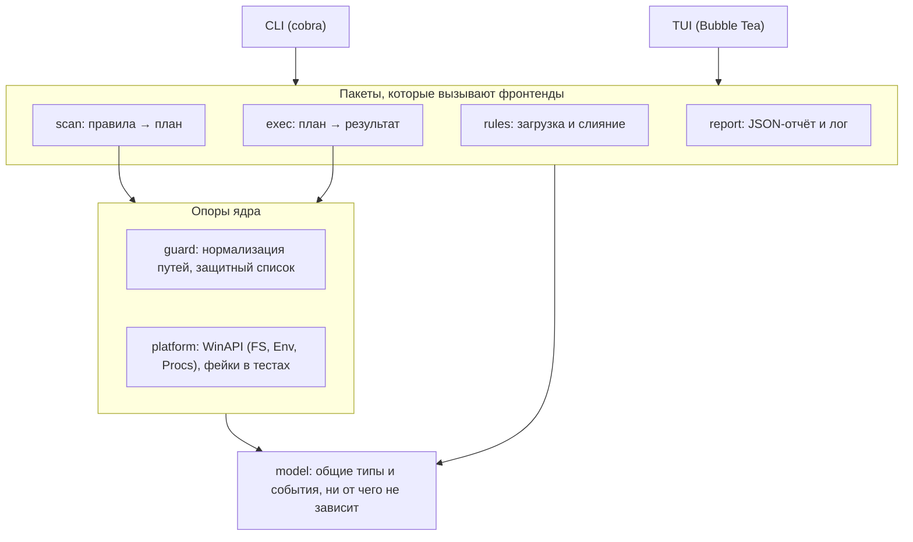
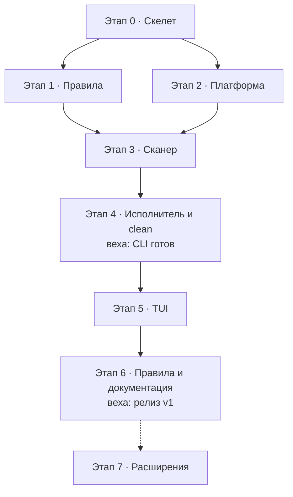

# Спецификация: Windows-очиститель с правилами (Go, CLI + TUI)

## Цель и принципы

Sweep (рабочее название) — утилита для ручной очистки Windows 10 и новее: вся очистка описана YAML-правилами, а Go-ядро только сканирует и исполняет их. Один бинарник, два интерфейса: `sweep` без аргументов открывает TUI, а `sweep scan` и `sweep clean` работают в скриптах и планировщике.

**Принципы**

- Правила — это данные. Новая очистка = новый YAML-файл, без правок Go-кода.
- Сначала план, потом удаление. Любое удаление проходит через сканирование и подтверждение; `--dry-run` ничего не меняет.
- Безопасность живёт в движке. Защитный список путей проверяется перед каждым удалением, и правило не может его обойти.
- Одно ядро, два фронтенда. CLI и TUI используют одни и те же типы и один поток событий.
- Один exe, без зависимостей, без сети, без телеметрии.

**Не входит в v1**

- чистка реестра и управление автозагрузкой;
- удаление программ;
- GUI, Linux и macOS (ядро не должно мешать их добавлению: всё, что трогает WinAPI, лежит в `internal/platform`);
- автообновление правил из сети.

**Как работать по этой спецификации**

- Этапы из раздела «Этапы реализации» идут по порядку; после каждого этапа `go test ./...` зелёный.
- Если решения нет в документе, берётся решение по умолчанию из раздела «Открытые вопросы и решения по умолчанию»; всё, что агент решил сам, он записывает в `docs/decisions.md`.
- Каждый путь в правилах проверяется на реальной Windows 10 и 11, а не принимается на веру из этого документа.

## Архитектура

Три слоя с односторонними зависимостями: фронтенды (CLI и TUI) загружают правила и вызывают сканер и исполнитель, а те обращаются к диску и Windows только через защиту и платформенный слой. Обратных импортов нет; `model` ни от чего не зависит.



Фронтенды загружают правила через `rules`, вызывают `scan` и `exec` и пишут отчёт через `report`; доступ к диску и Windows у ядра идёт только через `guard` и `platform`.

**Структура репозитория**

```
sweep/
├── cmd/sweep/main.go     # без аргументов в терминале → TUI, иначе CLI
├── internal/
│   ├── model/            # общие типы: Rule, Target, Plan, Event (без логики)
│   ├── rules/            # загрузка, валидация, слияние правил и конфига
│   ├── guard/            # защитный список, нормализация и проверка путей
│   ├── platform/         # WinAPI: атрибуты, корзина, процессы, UAC (build tag windows)
│   ├── scan/             # Scanner: правила → Plan, поток событий
│   ├── exec/             # Executor: Plan → Result, поток событий
│   ├── report/           # JSON-отчёт, jsonl-лог, форматирование размеров
│   ├── cli/              # команды cobra
│   └── tui/              # модель Bubble Tea
├── rules/                # встроенные правила, вшиваются через go:embed
│   └── browsers/ system/ dev/ apps/
├── schema/rule.schema.json
├── docs/                 # формат правил, decisions.md, гайд контрибьютора
└── testdata/             # фикстуры правил и деревьев файлов
```

Всё лежит в `internal/`: публичного Go-API в v1 нет, публичны только формат правил и CLI. Доступ к файловой системе и WinAPI идёт только через интерфейсы из `platform`, поэтому сканер и исполнитель тестируются на фейках.

**Зависимости**

| Назначение | Пакет |
| --- | --- |
| CLI | `github.com/spf13/cobra` |
| TUI | Bubble Tea, Bubbles, Lip Gloss (charmbracelet; проверить актуальные пути импорта) |
| YAML | `gopkg.in/yaml.v3` или его поддерживаемый форк (проверить на старте) |
| JSON Schema | `github.com/santhosh-tekuri/jsonschema/v6` |
| WinAPI | `golang.org/x/sys/windows` |
| Тесты TUI | `teatest` из `charmbracelet/x/exp` |

Всё остальное — стандартная библиотека (`io/fs`, `path/filepath`, `embed`, `context`, `log/slog`, `encoding/json`). Новая зависимость добавляется только с записью причины в `docs/decisions.md`.

## Формат правил

Файл правил — YAML с полями `schema: 1` и `rules: [...]`. Встроенные правила вшиты в бинарник, пользовательские лежат в `%APPDATA%\sweep\rules\*.yaml`. Источник правды — `schema/rule.schema.json`; ниже его смысл.

**Поля правила**

| Поле | Тип | Обязательно | Смысл |
| --- | --- | --- | --- |
| `id` | строка | да | уникальный, маска `^[a-z0-9]+(\.[a-z0-9-]+)+$`, например `browsers.chrome.cache` |
| `name` | строка | да | короткое имя для списка |
| `description` | строка | нет | что чистит и что случится после удаления |
| `category` | строка | да | `browsers`, `system`, `dev`, `apps`, `user` или своя |
| `risk` | `safe`, `moderate`, `dangerous` | да | safe — пересоздаётся само; moderate — пересоздаётся, но с затратами (повторная загрузка); dangerous — данные могут быть нужны человеку |
| `default_enabled` | bool | нет (false) | входит ли в профиль `default` |
| `tags` | список строк | нет | для выбора профилями, например `dev` |
| `requires_admin` | bool | нет | нужны права администратора |
| `requires_closed` | список имён процессов | нет | если процесс запущен, правило пропускается |
| `os_min_build` | число | нет | минимальная сборка Windows (10 1809 = 17763) |
| `trash` | bool | нет | в корзину вместо удаления; по умолчанию true для dangerous |
| `targets` | список | да | что удалять (поля ниже) |

**Поля цели (`targets[]`)**

| Поле | Смысл |
| --- | --- |
| `kind` | `path` (по умолчанию) или `command`; значение `find` зарезервировано под поиск по маркерам (этап 7) |
| `path` | путь с `%ENV%` и glob: `*`, `**`, `?` |
| `mode` | `contents` — содержимое найденных каталогов; `self` — сам найденный объект; `files` — только файлы, подходящие под `include` |
| `include`, `exclude` | glob-маски имён относительно `path` |
| `min_age_days` | брать только объекты, не менявшиеся столько дней |
| `min_size` | строка вида `50MB`: брать файлы не меньше этого размера |
| `cmd`, `args` | только для `kind: command`: внешняя команда и аргументы |

**Загрузка и слияние**

1. Порядок источников: встроенные → `%APPDATA%\sweep\rules\` → каталог из `--rules-dir`.
2. Правило с тем же `id` из более позднего источника заменяет предыдущее целиком (без глубокого слияния) и даёт предупреждение.
3. Файл `%APPDATA%\sweep\config.yaml` хранит `rules.<id>.enabled` (включить или выключить правило), `exclude_paths` (глобальные исключения), `allow_user_commands` (по умолчанию false) и `profiles`.
4. Профиль выбирает правила через `include` (маски id), `include_tags`, `include_categories`, `max_risk`, `exclude`. Встроенные профили: `default` (всё с `default_enabled: true`), `dev` (default плюс тег `dev`), `aggressive` (всё, кроме dangerous).
5. Пользовательское правило с `kind: command` отвергается, пока в конфиге не включён `allow_user_commands`.

**Валидация** идёт в два шага: JSON Schema (неизвестные поля — ошибка), затем смысловые проверки: компилируются glob-маски, неизвестная переменная окружения даёт предупреждение, `id` не повторяется внутри источника. Каждая ошибка указывает `файл:строка:столбец` (номера строк даёт узел YAML).

**Пример: встроенное правило**

```yaml
schema: 1
rules:
  - id: browsers.chrome.cache
    name: Chrome cache
    category: browsers
    risk: safe
    default_enabled: true
    requires_closed: [chrome.exe]
    targets:
      - path: '%LOCALAPPDATA%\Google\Chrome\User Data\*\Cache'
        mode: contents
      - path: '%LOCALAPPDATA%\Google\Chrome\User Data\*\Code Cache'
        mode: contents
```

**Пример: пользовательское правило с фильтрами**

```yaml
schema: 1
rules:
  - id: user.old-installers
    name: Old installers in Downloads
    category: user
    risk: dangerous
    targets:
      - path: '%USERPROFILE%\Downloads'
        mode: files
        include: ['*.exe', '*.msi', '*.iso']
        min_age_days: 90
```

## Контракты ядра

Сканер ничего не меняет и возвращает план; исполнитель принимает план и выбор пользователя. Оба сообщают о ходе работы потоком событий, поэтому CLI и TUI получают прогресс одинаково. Ниже — типы и интерфейсы, которые агент реализует как есть; имена можно уточнять, смысл — нет.

```go
package model

type Risk string

const (
	RiskSafe      Risk = "safe"
	RiskModerate  Risk = "moderate"
	RiskDangerous Risk = "dangerous"
)

type Kind string // path | command
type Mode string // contents | self | files

type Rule struct {
	ID, Name, Description, Category string
	Risk                            Risk
	DefaultEnabled, RequiresAdmin   bool
	Trash                           bool
	RequiresClosed, Tags            []string
	OSMinBuild                      int
	Targets                         []Target
	Source                          string // "builtin" или путь к файлу
}

type Target struct {
	Kind       Kind
	Path       string // как в YAML, до раскрытия переменных
	Mode       Mode
	Include    []string
	Exclude    []string
	MinAgeDays int
	MinSize    int64
	Cmd        string
	Args       []string
}

// Item — единица удаления. Без файловых фильтров это запись верхнего уровня
// (каталог целиком, с накопленными размером и числом файлов);
// с фильтрами (include, exclude, min_age_days, min_size) — отдельный файл.
type Item struct {
	Path    string
	Size    int64
	Files   int
	IsDir   bool
	ModTime time.Time
	Reparse bool // junction или symlink: удаляется сама ссылка, не цель
}

type SkipReason string // in_use, access_denied, protected, app_running, needs_admin, os_too_old, not_found

type Skip struct {
	Path   string
	Reason SkipReason
	Detail string
}

type RulePlan struct {
	Rule    *Rule
	Items   []Item
	Bytes   int64
	Files   int
	Skipped []Skip
	Command *CommandPlan // для kind: command; размер неизвестен
}

type Plan struct {
	Rules     []RulePlan
	CreatedAt time.Time
}

type Selection struct {
	Rules   map[string]bool // id правила → выбрано
	Exclude map[string]bool // пути items, снятые вручную
}

type ExecOptions struct {
	DryRun   bool
	Trash    *bool // nil — как в правиле; false запрещён для dangerous
	OnReboot bool  // отложить занятые файлы до перезагрузки (нужен admin)
	Workers  int
}

type Result struct {
	StartedAt, FinishedAt    time.Time
	FreedBytes, TrashBytes   int64
	Removed, Skipped, Failed int
	PerRule                  []RuleResult
	PendingReboot            []string
}

// Event — закрытый интерфейс; реализации ниже.
type Event interface{ isEvent() }

type RuleStarted struct{ RuleID string }
type RuleProgress struct {
	RuleID string
	Files  int
	Bytes  int64
}
type RuleScanned struct{ Plan RulePlan }
type ScanDone struct{ Plan *Plan }
type ItemRemoved struct {
	RuleID, Path string
	Bytes        int64
	ToTrash      bool
}
type ItemSkipped struct {
	RuleID string
	Skip   Skip
}
type ItemFailed struct {
	RuleID, Path string
	Err          error
}
type ExecDone struct{ Result *Result }
type Warning struct{ RuleID, Message string }

type Scanner interface {
	Scan(ctx context.Context, rules []*Rule, opt ScanOptions) <-chan Event
}

type Executor interface {
	Execute(ctx context.Context, plan *Plan, sel Selection, opt ExecOptions) <-chan Event
}
```

Платформенный слой (`internal/platform`) отдаёт ядру три интерфейса; настоящая реализация лежит под build tag `windows`, фейки — в тестах:

```go
type Env interface{ Get(name string) (string, bool) }

type Procs interface{ Running(names []string) ([]string, error) }

type FS interface {
	Lstat(path string) (Info, error)        // Info.Reparse берётся из FILE_ATTRIBUTE_REPARSE_POINT
	ReadDir(path string) ([]Info, error)
	Glob(pattern string) ([]string, error)  // поддерживает **, не заходит в reparse points
	Remove(path string) error               // файл или пустой каталог
	Trash(path string) error                // корзина
	RemoveOnReboot(path string) error       // MoveFileEx с MOVEFILE_DELAY_UNTIL_REBOOT
}
```

**Поведение, которое обязательно**

1. `Scan` и `Execute` возвращают буферизованный канал (около 256 событий) и сами его закрывают: после `ScanDone` или `ExecDone`, либо в течение секунды после отмены `ctx`. Потребитель читает до закрытия.
2. Сканируется до `runtime.NumCPU()` правил одновременно, внутри правила обход последовательный. Исполнитель обрабатывает правила параллельно, а items внутри правила — по очереди, чтобы вложенные пути не конфликтовали.
3. `RuleProgress` приходит не чаще раза в 100 мс на правило; троттлинг делает сканер, а не UI.
4. `Plan` после `ScanDone` не меняется. Выбор пользователя живёт отдельно, в `Selection`.
5. Ошибки отдельных путей — это события `ItemSkipped` и `ItemFailed`, а не ошибка вызова; одна плохая папка не останавливает очистку.
6. Правило с `kind: command` попадает в план как `CommandPlan` (команда, аргументы, размер неизвестен). Исполнитель запускает его через `exec.CommandContext` без shell, с таймаутом 10 минут, вывод пишет в лог.
7. Вся работа с файлами и процессами идёт через `platform.FS`, `Procs` и `Env`; прямых вызовов `os.*` и `os.Getenv` в `scan`, `exec` и `guard` быть не должно.

## Безопасность

Защита встроена в движок: пакет `guard` проверяет каждый путь дважды, при сканировании и прямо перед удалением, и правило из YAML не может это отключить. Кривое правило от сообщества должно в худшем случае ничего не найти, а не снести лишнее.

**Нормализация пути (до любой проверки)**

1. Раскрыть `%ENV%` через `platform.Env`; нераскрытая переменная — отказ.
2. Привести к абсолютному виду, выполнить `filepath.Clean`, убрать префикс `\\?\`, отбросить завершающие точки и пробелы.
3. Раскрыть короткие имена 8.3 (`PROGRA~1`) через `GetLongPathName`.
4. Для корня цели разрешить симлинки и junction и проверить оба пути: исходный и итоговый.
5. Сравнивать без учёта регистра.
6. Цель должна лежать на фиксированном локальном диске; съёмные, сетевые и UNC-пути отвергаются.

**Защитный список**

| Группа | Пути | Что запрещено |
| --- | --- | --- |
| Корни | корни дисков, `C:\Windows`, `C:\Program Files`, `C:\Program Files (x86)`, `C:\ProgramData`, `C:\Users`, профиль пользователя, `%APPDATA%`, `%LOCALAPPDATA%` | удалять сами эти каталоги или целиться в них через `mode: contents` |
| Системные поддеревья | `Windows\System32`, `SysWOW64`, `WinSxS`, `Boot`, `Fonts`, `Recovery`, `System Volume Information`, `$Recycle.Bin`, `EFI`, всё внутри Program Files | любые изменения внутри; WinSxS чистит только команда DISM |
| Данные пользователя | Desktop, Documents, Pictures, Videos, Music, Downloads, OneDrive | `contents` и `self` без фильтров; разрешён `mode: files` с `include` и `min_age_days` |
| Исключения внутри Windows | `Windows\Temp`, `Windows\SoftwareDistribution\Download`, `Windows\Logs`, `Windows\Minidump`, `Windows\ServiceProfiles\NetworkService\AppData\Local\Microsoft\Windows\DeliveryOptimization` | явный список поверх запрета на `C:\Windows`; расширять его можно только правкой кода `guard` вместе с тестами |

Глобальные `exclude_paths` из конфига только добавляются к этому списку и никогда его не сужают.

**Правила удаления**

1. Reparse points. Обход не заходит в junction и симлинки; `Item.Reparse = true`, удаляется сама ссылка, цель не трогается. Определять по атрибутам файла через `golang.org/x/sys/windows`, а не по `ModeSymlink`: в части версий Go junction под этот режим не попадает.
2. Повторная проверка перед удалением. Прямо перед `Remove` выполняются `Lstat` и `guard`; если путь успел стать reparse point или попал под защиту, событие `ItemSkipped` с причиной `protected`.
3. Занятые файлы. Ошибки Windows 5, 32 и 33 дают `ItemSkipped` с причиной `in_use` или `access_denied`, работа продолжается. С `OnReboot` для правил ниже dangerous используется `MoveFileEx` с `MOVEFILE_DELAY_UNTIL_REBOOT`, путь попадает в `Result.PendingReboot`.
4. `requires_closed`. Перед правилом вызывается `Procs.Running`; если процесс жив, правило пропускается целиком с причиной `app_running`. Закрывать чужие процессы утилита не умеет и не должна.
5. `requires_admin` без повышенных прав. Правило пропускается с причиной `needs_admin`, а не падает на середине.
6. Корзина. `trash: true` ведёт в `FS.Trash`; для dangerous это значение по умолчанию, и `--no-trash` для них запрещён. Место освобождается только после очистки корзины, поэтому отчёт считает `TrashBytes` отдельно от `FreedBytes`.
7. Dry-run. Исполнитель с `DryRun: true` идёт тем же путём, но вместо `Remove` и `Trash` только пишет события. Тест сравнивает хэш дерева файлов до и после.
8. Лог. Каждая операция дописывается в `%LOCALAPPDATA%\sweep\logs\YYYY-MM-DD.jsonl`: время, правило, путь, действие, размер, результат. Если лог не открылся, очистка не стартует.
9. Подтверждение dangerous. В CLI нужны `--include-dangerous` и отдельное подтверждение, в TUI — ввод слова `yes`.

**Обязательные тесты `guard`.** Не меньше 50 табличных случаев: `..` в пути, смешанный регистр, префикс `\\?\`, имена 8.3, завершающие точки и пробелы, junction на `C:\Windows\System32`, UNC-путь, корни дисков, неизвестная переменная. Плюс `go test -fuzz` на нормализации путей: минимум минута без паник.

## CLI

CLI — тонкая обёртка над ядром на `cobra`: разбирает флаги, собирает правила и профиль, запускает `Scan` или `Execute` и печатает события. Вывод для человека — текст, для скриптов — `--json`; бизнес-логики в `internal/cli` нет.

**Команды**

| Команда | Что делает |
| --- | --- |
| `sweep` | открывает TUI; если stdout не терминал, печатает справку |
| `sweep list` | правила: id, риск, входит ли в профиль, нужен ли admin; флаги `--category`, `--profile`, `--json` |
| `sweep scan` | сканирует без изменений и печатает таблицу правил с размерами |
| `sweep clean` | скан, план, подтверждение, удаление |
| `sweep rules validate [путь...]` | проверяет файлы правил; без аргументов проверяет всё, что загружается |
| `sweep rules show <id>` | итоговое правило после слияния и раскрытия переменных, удобно для отладки путей |
| `sweep config path` | пути конфига, каталога правил и логов |
| `sweep version` | версия и сборка |

**Флаги**

| Флаг | Команды | Смысл |
| --- | --- | --- |
| `--profile <имя>` | scan, clean, list | профиль правил, по умолчанию `default` |
| `--rule <id или маска>` | scan, clean | выбрать правило явно; флаг повторяется и перекрывает профиль |
| `--dry-run` | clean | показать план и выйти |
| `--yes` | clean | не спрашивать подтверждение |
| `--trash`, `--no-trash` | clean | в корзину или сразу удалять; для dangerous `--no-trash` запрещён |
| `--include-dangerous` | clean | разрешить правила с `risk: dangerous` |
| `--on-reboot` | clean | отложить занятые файлы до перезагрузки |
| `--report <файл>` | clean | записать JSON-отчёт в файл |
| `--json` | scan, clean, list | машинный вывод в stdout |
| `--rules-dir`, `--config`, `--no-color`, `--ascii`, `-v` | все | общие флаги |

**Поведение**

- `clean` в терминале печатает план и спрашивает `Continue? [y/N]`. Без терминала и без `--yes` команда завершается с кодом 3, ничего не удалив.
- Цвет отключается при `NO_COLOR` или когда вывод не терминал.
- При `--json` в stdout идёт один JSON-документ, а предупреждения и логи — в stderr.
- Ctrl+C отменяет `ctx`; команда дожидается закрытия канала событий и печатает частичный итог.

**Коды возврата**

| Код | Значение |
| --- | --- |
| 0 | успех, включая dry-run |
| 1 | внутренняя ошибка |
| 2 | ошибка флагов, конфига или правил |
| 3 | нужно подтверждение, а терминала нет |
| 4 | завершено частично: есть пропущенные или упавшие элементы |

**Формат JSON-отчёта** версионируется полем `schema`; поля только добавляются, существующие не меняют смысл. Статусы правила: `done`, `skipped`, `failed`, `dry_run`.

```json
{
  "schema": 1,
  "started_at": "2026-10-14T13:00:00+03:00",
  "finished_at": "2026-10-14T13:00:09+03:00",
  "dry_run": false,
  "summary": {
    "rules": 6, "items": 412, "files": 38211,
    "bytes_found": 4510000000, "bytes_freed": 4390000000, "bytes_trashed": 0,
    "skipped": 12, "failed": 0
  },
  "rules": [
    {
      "id": "browsers.chrome.cache",
      "status": "done",
      "bytes": 812000000,
      "files": 9120,
      "skipped": [ { "path": "C:\\Temp\\x.tmp", "reason": "in_use" } ]
    }
  ],
  "pending_reboot": []
}
```

## TUI

TUI — второй фронтенд на Bubble Tea. Он открывается командой `sweep` и делает то же, что `scan` и `clean`, но с выбором галочками. Модель следует схеме Model, Update, View; события ядра приходят в `Update` как `tea.Msg`. Мышь поддерживается как дополнение, всё управляется с клавиатуры.

**Экраны**

1. Скан. Стартует сразу при запуске: список правил с живыми размерами и спиннером у тех, что ещё сканируются. Листать и отмечать можно, не дожидаясь конца.
2. Список. Дерево «категория → правило → items». Колонки: чекбокс, имя, бейдж риска (`SAFE`, `MOD`, `DANGER` текстом; цвет только усиливает), размер, число файлов. Начальный выбор — профиль `default`.
3. Детали. Панель справа (при ширине от 100 колонок) или снизу: описание, пути целей, предупреждения: `[A]` — нужен admin, список `requires_closed` с пометкой, запущены ли эти процессы сейчас.
4. Подтверждение. Сводка: сколько правил, какой размер, сколько уйдёт в корзину; отдельным блоком dangerous; переключатель «корзина или удалить». Для dangerous нужно ввести `yes`.
5. Выполнение. Прогресс-бар по байтам, текущее правило, лента пропущенных и упавших элементов.
6. Итог. Освобождено, в корзине, пропущено, ошибки по правилам; клавиша `s` сохраняет JSON-отчёт.

**Клавиши**

| Клавиша | Действие |
| --- | --- |
| ↑ ↓, `k` `j` | перемещение |
| → или Enter, ← | раскрыть, свернуть |
| Space | отметить или снять правило или item |
| `a` | отметить все safe |
| `n` | снять всё |
| `o` | сортировка: по размеру или по имени |
| `/` | фильтр по имени |
| `d` | панель деталей |
| `t` | корзина или удаление |
| `r` | повторный скан |
| `c` | перейти к подтверждению |
| `?` | помощь по клавишам |
| Esc | назад |
| `q` | выход; во время выполнения — с подтверждением |

**Как устроено внутри**

- Экраны — `type screen int`: scanning, list, confirm, running, done. В `Model` лежат `plan`, `sel`, курсор, фильтр, канал событий и размер окна.
- Канал читает команда `waitEvent(ch) tea.Cmd`: она ждёт одно событие и возвращает его как `tea.Msg`; `Update` обработал событие и снова возвращает эту команду, пока канал не закрыт.
- Перерисовка пачками: обработчик накапливает события не дольше 50 мс или до 50 штук, чтобы UI не перерисовывался на каждый файл.
- Размер окна приходит как `tea.WindowSizeMsg`. Минимум 80×24; меньше — экран с просьбой увеличить окно.
- Ширину строк считать через `lipgloss.Width` или `go-runewidth`, а не через `len`.

**Windows 10**

- Лучше всего работает Windows Terminal; старый conhost хуже рисует рамки и Unicode. Режим `--ascii` (или `SWEEP_ASCII=1`) заменяет рамки и полосу прогресса на ASCII (`+-|`, `#-`); автоопределение идёт по `WT_SESSION` и кодовой странице консоли, `--ascii` и `--no-ascii` его перекрывают.
- Эмодзи не использовать: их ширина в терминалах разная и ломает выравнивание. Чекбокс всегда `[x]` и `[ ]`.
- Повышение прав. Если выбраны правила с `requires_admin`, а процесс не повышен, экран подтверждения предлагает «Restart as administrator». При согласии вызывается `ShellExecuteW` с глаголом `runas`, передаётся скрытый флаг `--preselect id1,id2,...`, исходный процесс завершается. Новый экземпляр сразу сканирует и отмечает эти правила. Если UAC отклонён, пользователь возвращается к подтверждению, а admin-правила снимаются с выбора.

**Тесты TUI.** `teatest` с фейковым ядром: снимки экранов списка, подтверждения и итога в обычном и ASCII-режиме.

## Встроенные правила v1

Стартовый набор покрывает браузеры, систему, инструменты разработки и несколько Electron-приложений. Пути здесь — исходная гипотеза, а не проверенный факт: агент проверяет каждый на Windows 10 и 11 (приложение есть, папка существует и действительно является кэшем) и фиксирует результат в `docs/rules.md`. Правило, путь которого не подтвердился, удаляется из набора, а не остаётся «на всякий случай».

| ID | Пути | Риск | В `default` | Admin |
| --- | --- | --- | --- | --- |
| `browsers.chrome.cache` | `%LOCALAPPDATA%\Google\Chrome\User Data\*\` → `Cache`, `Code Cache`, `GPUCache`; закрыт `chrome.exe` | safe | да | нет |
| `browsers.edge.cache` | `%LOCALAPPDATA%\Microsoft\Edge\User Data\*\` → `Cache`, `Code Cache`, `GPUCache`; закрыт `msedge.exe` | safe | да | нет |
| `browsers.firefox.cache` | `%LOCALAPPDATA%\Mozilla\Firefox\Profiles\*\cache2`; закрыт `firefox.exe` | safe | да | нет |
| `system.user-temp` | `%TEMP%`, старше 1 дня | safe | да | нет |
| `system.windows-temp` | `%SystemRoot%\Temp`, старше 1 дня | safe | да | да |
| `system.wer-user` | `%LOCALAPPDATA%\Microsoft\Windows\WER` | safe | да | нет |
| `system.wer-machine` | `%ProgramData%\Microsoft\Windows\WER\ReportArchive`, `ReportQueue` | safe | да | да |
| `system.cbs-logs` | `%SystemRoot%\Logs\CBS\*.log`, старше 14 дней | safe | да | да |
| `system.crash-dumps` | `%LOCALAPPDATA%\CrashDumps` | moderate | нет | нет |
| `system.minidumps` | `%SystemRoot%\Minidump`, `%SystemRoot%\MEMORY.DMP` (`mode: self`) | moderate | нет | да |
| `system.windows-update-cache` | `%SystemRoot%\SoftwareDistribution\Download`; службы не останавливаются, занятые файлы пропускаются | moderate | нет | да |
| `system.delivery-optimization` | `%SystemRoot%\ServiceProfiles\NetworkService\AppData\Local\Microsoft\Windows\DeliveryOptimization\Cache` | safe | нет | да |
| `system.thumbnail-cache` | `%LOCALAPPDATA%\Microsoft\Windows\Explorer\thumbcache_*.db` (`mode: files`); Explorer держит часть файлов | safe | нет | нет |
| `system.recycle-bin` | команда `powershell.exe -NoProfile -Command Clear-RecycleBin -Force` | moderate | нет | нет |
| `system.component-cleanup` | команда `dism.exe /Online /Cleanup-Image /StartComponentCleanup` (без `/ResetBase`) | moderate | нет | да |
| `dev.npm-cache` | `%LOCALAPPDATA%\npm-cache` | safe | нет, тег `dev` | нет |
| `dev.pnpm-store` | `%LOCALAPPDATA%\pnpm\store` | moderate | нет, тег `dev` | нет |
| `dev.yarn-cache` | `%LOCALAPPDATA%\Yarn\Cache` | safe | нет, тег `dev` | нет |
| `dev.pip-cache` | `%LOCALAPPDATA%\pip\Cache` | safe | нет, тег `dev` | нет |
| `dev.go-build-cache` | `%LOCALAPPDATA%\go-build` | safe | нет, тег `dev` | нет |
| `dev.nuget-cache` | `%LOCALAPPDATA%\NuGet\v3-cache`, `%TEMP%\NuGetScratch` | safe | нет, тег `dev` | нет |
| `dev.gradle-caches` | `%USERPROFILE%\.gradle\caches` | moderate | нет, тег `dev` | нет |
| `dev.docker-prune` | команда `docker system prune -f` (контейнеры и образы, тома не трогаются) | dangerous | нет, тег `dev` | нет |
| `apps.vscode.cache` | `%APPDATA%\Code\` → `Cache`, `CachedData`, `CachedExtensionVSIXs`, `Code Cache`, `GPUCache`; закрыт `Code.exe` | safe | да | нет |
| `apps.discord.cache` | `%APPDATA%\discord\` → `Cache`, `Code Cache`, `GPUCache`; закрыт `Discord.exe` | safe | да | нет |
| `apps.slack.cache` | `%APPDATA%\Slack\` → `Cache`, `Code Cache`, `GPUCache`; закрыт `slack.exe` | safe | да | нет |

Правила для всех остальных программ добавляет сообщество через pull request по шаблону из `CONTRIBUTING.md`; код при этом не меняется.

## Тестирование и CI

Логику ядра проверяем на фейках без диска, а всё, что может повредить файлы, — интеграционными тестами на реальной Windows. Без зелёных тестов `guard` этап не считается законченным.

| Уровень | Что проверяет | Как |
| --- | --- | --- |
| Юнит | загрузчик и валидатор правил, раскрытие glob и переменных, слияние источников | табличные тесты и golden-файлы в `testdata/rules/valid` и `testdata/rules/invalid` (для невалидных — ожидаемый текст ошибки с `файл:строка:столбец`) |
| `guard` | защитный список и нормализация путей | не меньше 50 кейсов и `go test -fuzz` |
| Сканер и исполнитель | фильтры, события, отмена, dry-run, причины пропусков | фейковые `platform.FS`, `Env`, `Procs` в памяти |
| Интеграционные, build tag `windows` | реальное поведение ОС | `t.TempDir()`, кейсы ниже |
| TUI | экраны и переходы | `teatest`, снимки в обычном и ASCII-режиме |
| Встроенные правила | каждый файл в `rules/` | один тест гоняет все: схема валидна, `id` уникальны, раскрытые пути проходят `guard` |

**Интеграционные кейсы Windows**

- junction на каталог-приманку: обход не заходит внутрь, приманка цела, удалена только сама ссылка;
- файл, открытый без `FILE_SHARE_DELETE`: `ItemSkipped` с причиной `in_use`, остальное удалено;
- пути длиннее 260 символов; имена с Unicode, завершающей точкой и пробелом;
- `clean --dry-run`: хэш дерева файлов до и после совпадает;
- корзина: `FS.Trash` кладёт файл в корзину, `Result.TrashBytes` больше нуля.

**CI (GitHub Actions)**

- `windows-latest`: `go build ./...`, `go vet ./...`, `go test ./...` вместе с интеграционными, `golangci-lint`.
- `ubuntu-latest`: только пакеты без WinAPI (`model`, `rules`) как быстрый ранний сигнал.
- Fuzz: короткий прогон (30 секунд) на каждый pull request, длинный — раз в неделю по расписанию.
- Релиз по тегу через `goreleaser`: zip с `sweep.exe` для windows/amd64 (windows/arm64 по возможности) и контрольные суммы SHA-256.
- Перед релизом — ручной чек-лист на чистых виртуальных машинах с Windows 10 22H2 и Windows 11: скан, dry-run, `clean` с обычным и повышенным процессом, UAC-перезапуск из TUI, работа в conhost и в Windows Terminal.

## Этапы реализации

Восемь этапов: этапы 1 и 2 можно вести параллельно, как только готовы типы `model`, остальные идут цепочкой. Каждый этап заканчивается зелёными `go test ./...` и CI, а условие «Готово, когда» проверяется командой или тестом, а не на глаз. После этапа 4 утилита уже полезна: CLI работает целиком.



### Этап 0. Скелет

- `go mod init`, структура из раздела «Архитектура», `cmd/sweep` с командой `version`.
- CI на `windows-latest`, `golangci-lint`, `LICENSE` (см. открытые вопросы), `README` с описанием и статусом.

**Готово, когда:** `go build ./...` и CI зелёные, `sweep version` печатает версию.

### Этап 1. Правила

- Типы в `model`, YAML-загрузчик, `schema/rule.schema.json`, двухшаговая валидация, слияние встроенных, пользовательских правил и конфига, профили.
- Команды `rules validate`, `rules show`, `list`; три встроенных правила для проверки: Chrome cache, user-temp, npm cache.

**Готово, когда:** 20 и более невалидных фикстур дают ожидаемые ошибки с `файл:строка:столбец`; `sweep list --json` выводит встроенные правила; правило с тем же `id` из пользовательского каталога заменяет встроенное и даёт предупреждение.

### Этап 2. Guard и platform

- `platform`: реализации `Env`, `FS`, `Procs` для Windows (атрибуты reparse points, `GetLongPathName`, `GetDriveType`, `Glob` с `**`, корзина, `MoveFileEx`, список процессов) и фейки для тестов.
- `guard`: нормализация, защитный список, проверка пары «режим плюс каталог данных пользователя».

**Готово, когда:** 50 и более кейсов `guard` зелёные, fuzz 60 секунд без паник, интеграционный тест с junction проходит.

### Этап 3. Сканер

- Раскрытие путей, фильтры, формирование `Item` (запись верхнего уровня или файл), параллелизм, события, троттлинг, отмена.
- Команда `sweep scan` с таблицей и `--json`.

**Готово, когда:** память скана не растёт линейно с числом файлов в каталоге-кэше (достаточно `Item` верхнего уровня); Ctrl+C завершает команду не дольше чем за секунду; `scan --json` совпадает с `Plan`.

### Этап 4. Исполнитель и `clean`

- Удаление, корзина, причины пропусков, `requires_closed`, `requires_admin`, dry-run, лог jsonl, JSON-отчёт, коды возврата, подтверждение, цели `kind: command`.

**Готово, когда:** все интеграционные кейсы Windows из раздела «Тестирование и CI» зелёные; `clean --dry-run` не меняет дерево файлов; без терминала и без `--yes` команда возвращает код 3.

### Этап 5. TUI

- Экраны 1–6, клавиши, пачечная перерисовка, ASCII-режим, UAC-перезапуск с `--preselect`.

**Готово, когда:** снимки `teatest` совпадают; на Windows 10 интерфейс читается и в Windows Terminal, и в conhost; `--ascii` не ломает выравнивание; перезапуск через UAC возвращает на экран с теми же отмеченными правилами.

### Этап 6. Полный набор правил и документация

- Все правила из раздела «Встроенные правила v1», проверенные на Windows 10 и 11; `docs/rules.md` с результатом проверки каждого пути.
- `docs/format.md` (формат правил на примерах), `CONTRIBUTING.md` с шаблоном правила и чек-листом ревью, `README` со скриншотом TUI.

**Готово, когда:** тест всех встроенных правил зелёный, а каждый путь в `docs/rules.md` отмечен как проверенный с указанием версии Windows.

### Этап 7. Расширения после первого релиза

- `kind: find`: поиск каталогов по маркеру, например `node_modules` рядом с `package.json`, не менявшиеся N дней.
- Режим «крупные папки» в стиле ncdu, поиск дубликатов, правило для `Windows.old`, manifest для scoop.

**Готово, когда:** критерий задаётся отдельно для каждого пункта перед его началом.

## Открытые вопросы и решения по умолчанию

Эти вопросы не блокируют старт: по каждому указано решение, и агент идёт по нему, пока владелец проекта не ответил иначе.

| Вопрос | Решение по умолчанию |
| --- | --- |
| Имя проекта и Go-модуль | `sweep`, модуль `github.com/<owner>/sweep`; имя меняется одной заменой |
| Лицензия | MIT; файл `LICENSE` нужен уже на этапе 0. Вариант GPL-3.0 защищает от закрытых форков, но может отпугнуть часть контрибьюторов |
| Язык интерфейса | английский в v1; все строки собраны в одном месте, чтобы добавить русский позже; имена и описания правил только английские |
| Минимальная Windows | 10 1809 (сборка 17763); для отдельных правил — через `os_min_build` |
| Платформа сборки | windows/amd64 основная, windows/arm64 по возможности |
| Закрытие запущенных приложений | утилита процессы не закрывает: правило с `requires_closed` пропускается, а причина показывается |
| Корзина | включена для dangerous; для moderate и safe по умолчанию удаление сразу, `--trash` включает корзину |
| Prefetch | не чистим: после очистки программы запускаются медленнее |
| Службы Windows Update | в v1 не останавливаем; занятые файлы пропускаются |
| Где лежат данные | конфиг и пользовательские правила в `%APPDATA%\sweep`, логи в `%LOCALAPPDATA%\sweep\logs` |
